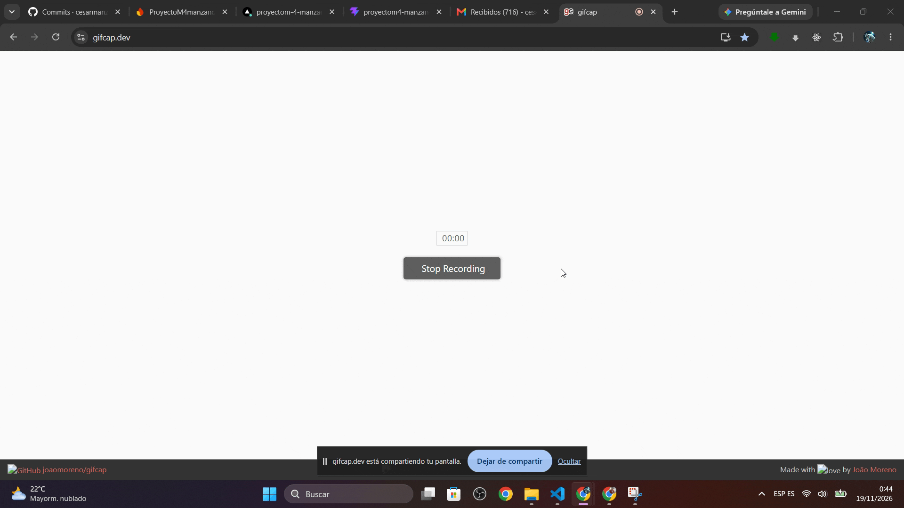

# MateCode — Aplicaciones Web para tu Empresa

Aplicación de gestión de tareas con autenticación segura, persistencia en la nube, verificación de identidad por correo y envío de resúmenes automáticos mediante AWS SES.

- **Demo en producción:** [Ver aplicación en Vercel](https://proyectom-4-manzano-cesar-luis-ao8r4leuu-cesar-4a0d.vercel.app/)

## Capturas de Pantalla


## Cómo recibir los resúmenes de tareas

1. Presioná el botón **ENVIAR RESUMEN** y te llegará un correo de AWS.
2. Ingresá al enlace de verificación (esto ocurre la primera vez).
3. Regresá a la aplicación y presioná **ENVIAR RESUMEN** nuevamente para recibir el reporte de tus tareas en tu correo.



## Características Principales

- **Autenticación Flexible:** Registro e inicio de sesión mediante correo/contraseña o acceso rápido con **Google OAuth** (Firebase Auth).
- **Verificación de Correo Obligatoria:** Al presionar el botón de enviar resúmenes por primera vez, el sistema envía automáticamente un correo de verificación a través de **Amazon Simple Email Service (AWS SES)**. Una vez validada tu dirección, podés recibir los reportes en tu correo.
- **Resúmenes por Correo Electrónico:** Envío de reportes detallados con el progreso general y el estado de tus actividades directamente a tu bandeja de entrada.
- **Carpetas y Prioridades Dinámicas:** Organizá tus tareas en *Principal*, *Pendientes*, *En Proceso*, *Completadas* y *Urgentes*, y asignales prioridades (*Baja*, *Media*, *Alta*, *Urgente*) con selectores interactivos.
- **Vista de Calendario:** Visualización mensual integrada de tus entregas y fechas límite.
- **Papelera de Reciclaje (Soft Delete):** Envío de tareas a la papelera con opción de restaurarlas o eliminarlas de forma definitiva.
- **Diseño Mobile-First & Responsivo:** Barra lateral deslizante (*drawer*) optimizada para computadoras, tablets y dispositivos móviles.

## Tecnologías Utilizadas

- **Frontend:** React 19, TypeScript, Vite, React Router DOM.
- **Backend & Base de Datos:** Firebase Auth, Firebase Firestore, Firebase Admin.
- **Servicios Cloud / Email:** AWS SDK v3 (`@aws-sdk/client-sesv2`), Serverless API (Vercel Functions).
- **Testing y Calidad:** Vitest, Testing Library, JSDOM.
- **Despliegue:** Desplegado en **Vercel**.

## Uso de Inteligencia Artificial (IA)
Durante el desarrollo de MateCode utilicé herramientas de Inteligencia Artificial como apoyo para agilizar algunas tareas y resolver dificultades técnicas que surgieron durante la implementación del proyecto.

Los principales usos fueron:

- **Generación de recursos visuales:** Utilicé IA para generar imágenes  que ayudaron a mejorar la identidad visual y la presentación de la aplicación.
- **Resolución de errores técnicos:** Utilicé IA como asistencia para identificar y solucionar errores relacionados con la configuración de Amazon SES (Simple Email Service), especialmente durante la integración del servicio de correo electrónico.
- **Comprensión y depuración del código:** La IA también fue utilizada para comprender errores, analizar posibles soluciones y mejorar la implementación de determinadas funcionalidades.

La Inteligencia Artificial fue utilizada como una herramienta de asistencia durante el desarrollo. Las soluciones propuestas fueron revisadas, adaptadas y probadas dentro del proyecto para comprobar su correcto funcionamiento.


## Arquitectura del Proyecto

```text
api/
├── send-summary.ts          # Función serverless para enviar el reporte de tareas vía AWS SES
└── verify-email.ts          # Función serverless para crear la identidad y verificar el correo en AWS SES
src/
├── assets/                  # Imágenes, capturas y logotipos institucionales
├── components/              # Componentes reutilizables (TaskFormModal, CalendarView, TrashView, EmailSummaryButton, UserProfileHeader)
├── docIA/                   # Documentacion de IA
├── context/                 # Context API de autenticación (AuthContext)
├── features/                # Funcionalidades específicas y tipos compartidos
├── hooks/                   # Custom hooks para la gestión de datos en Firestore (useTasks)
├── pages/                   # Vistas principales (LoginPage, RegisterPage, DashboardPage)
├── routes/                  # Configuración de rutas protegidas y AppRouter
├── services/                # Inicialización de Firebase y servicios de tareas/autenticación
├── app.css
├── app.txt
├── index.css
└── main.txt
test/
├── RegisterPage.test.tsx
├── send-email.test.ts
└── TaskFormModal.test.tsx


```

## Variables de Entorno

Crea un archivo `.env` en la raíz del proyecto basándote en la siguiente estructura:

| Variable | Descripción |
|---|---|
| `VITE_FIREBASE_API_KEY` | API Key pública de Firebase |
| `VITE_FIREBASE_AUTH_DOMAIN` | Dominio de autenticación de Firebase |
| `VITE_FIREBASE_PROJECT_ID` | ID del proyecto de Firebase |
| `VITE_FIREBASE_STORAGE_BUCKET` | Almacenamiento de Firebase |
| `VITE_FIREBASE_MESSAGING_SENDER_ID` | Sender ID de mensajería |
| `VITE_FIREBASE_APP_ID` | App ID de Firebase |
| `FIREBASE_PRIVATE_KEY` | Llave privada de Firebase Admin (para serverless) |
| `FIREBASE_CLIENT_EMAIL` | Email de cliente de Firebase Admin |
| `AWS_REGION` | Región de AWS (ej. `us-east-2`) |
| `AWS_ACCESS_KEY_ID` | Credencial de acceso de AWS |
| `AWS_SECRET_ACCESS_KEY` | Llave secreta de AWS |
| `SES_FROM` | Dirección de correo verificada remitente en AWS SES |

## 🧪 Instalación y Uso Local

```bash
git clone <https://github.com/cesarmanzano1/ProyectoM4_MANZANO-CESAR-LUIS-.git >
```
```bash
cd proyectom4-manzano-cesar-luis
```
```bash
npm install
```
# Configura tus variables en el archivo .env
```bash
npm run dev
```

## 📜 Scripts Disponibles

*  — Levanta el servidor de desarrollo local con Vite.
```bash
`npm run dev`
```
*  — Genera el build de producción optimizado.
```bash
`npm run build`
```
*  — Ejecuta las pruebas unitarias e de integración con Vitest.
```bash
`npm run test`
```


## 👥 Autores

Proyecto desarrollado por Cesar luis Manzano para el módulo 4 **MateCode**.